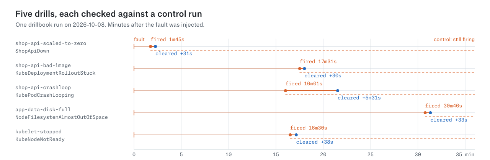
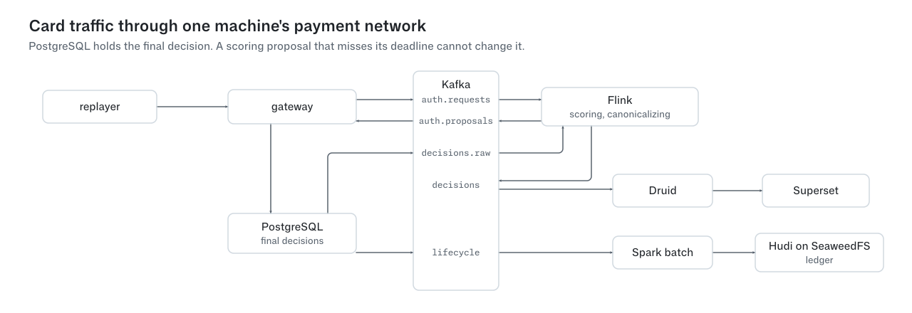

<picture>
  <source media="(prefers-color-scheme: dark)" srcset="header/heads-dark.svg">
  <source media="(prefers-color-scheme: light)" srcset="header/heads-light.svg">
  
</picture>

<strong>Systems engineering, infrastructure and mechanistic interpretability</strong> 
Computer science at PES University, Bengaluru

I build across the stack, from storage and stream processing to GPU experiments and model internals. The part I like is where a design meets a real machine: a node disappears, a deadline expires, or a measurement disagrees with the explanation.

Every figure on this page is drawn from a recorded run or from the project's own code. The data behind each one is checked into this repository, and the section at the bottom says where it came from.

## Systems I'm building

### [drillbook](https://github.com/VivianSobers/drillbook): runbooks you can put to the test

<picture>
  <source media="(prefers-color-scheme: dark)" srcset="figures/drills/drills-dark.svg">
  <source media="(prefers-color-scheme: light)" srcset="figures/drills/drills-light.svg">
  
</picture>

Inject a fault, check that the Prometheus alert fires and reaches the right receiver, run the runbook, and check that the alert clears. Then repeat the fault without the fix as a control. All five included drills pass with their controls holding.

Go · Prometheus · Alertmanager · Kubernetes · Helm · Terraform · Ansible

### [swipeline](https://github.com/VivianSobers/swipeline): a payment network on one machine

<picture>
  <source media="(prefers-color-scheme: dark)" srcset="figures/swipeline/swipeline-dark.svg">
  <source media="(prefers-color-scheme: light)" srcset="figures/swipeline/swipeline-light.svg">
  
</picture>

Repeatable synthetic card traffic, durable authorization decisions and streaming analytics. PostgreSQL records the final outcome, Kafka and Flink handle scoring, and Druid and Superset make the network observable. A scoring proposal that misses its deadline cannot overwrite a decision already made.

Go · PostgreSQL · Kafka · Flink · Druid · Superset · Spark · Hudi

### [gavel](https://github.com/VivianSobers/gavel) — Auctions on the BEAM

A clustered auction service with Gleam bidding rules and Elixir/OTP processes. The work centers on ordered event histories, request deduplication, ownership changes, and rebuilding auction state from PostgreSQL. **In progress**, with a Phoenix LiveView interface planned.

Elixir · Gleam · Erlang/OTP · PostgreSQL · Phoenix

## Experiments with evidence

- **[qk-attribution](https://github.com/VivianSobers/qk-attribution)** — Decomposing attention scores into query/key feature interactions to investigate why a language model attends where it does. The corrected score form reproduces Qwen3-0.6B's attention scores to **2.5 × 10⁻⁷ median relative error across all 448 heads**. My [open circuit-tracer contribution](https://github.com/decoderesearch/circuit-tracer/pull/114) splits attribution edges across the heads that carried them.

- **[gpunap](https://github.com/VivianSobers/gpunap)** — Testing whether CUDA jobs can pause into host RAM and resume intact. **388 completed pause/resume cycles across nine workload types**, with bit-for-bit agreement against uninterrupted runs. The repository includes an installable validation CLI and documents the driver hazards; the scheduler remains future work.

- **[Differentiable Rasterizer](https://github.com/VivianSobers/Differentiable-Rasterizer)** — A Rust renderer that runs backwards: optimize triangle positions, colors, and opacity to reconstruct an image. The recorded 150-triangle fit reduces loss **606×**. Includes a PyTorch autograd layer and a WebAssembly viewer.

- **[Stormbreaker](https://github.com/VivianSobers/Stormbreaker)** — Learning per-machine models of Linux power consumption to estimate which applications drain the battery. **4.2% final-energy error over a held-out 27.6-minute discharge**; the repository separately measures the weaker per-application attribution claim.

## Tools for real work

**[ORCA](https://github.com/VivianSobers/ORCA)** reads an unfamiliar repository, identifies its services, and generates a Docker setup with evidence behind each decision. Available as [`orca-agent-cli`](https://www.npmjs.com/package/orca-agent-cli).

**[Private Cloud](https://github.com/VivianSobers/Private-Cloud)** is a team-built, self-hosted file and photo platform. My focus: the **web client, media pipeline, and intelligence tier**, including OCR, semantic search, and photo features.

---

**Languages I work with:** Go, Python, Rust, TypeScript, C, Elixir, and Gleam.  
**Problems I keep coming back to:** recovery, reproducibility, observability, and understanding what a model actually computes.

<!-- header:start -->

How the header was made

Qwen/Qwen3-0.6B at revision `c1899de` read the line twice, 20 tokens in all, in float32 on the CPU with eager attention and seed 0. I scored all 448 heads on four behaviours. The header shows the best head for each, and no head is shown for two behaviours.

| Head | Scored by | Shown | Score | Next best |
|:--|:--|:--|--:|:--|
| First-token head | Mean weight on the first word | layer 16, head 11 | 0.99 | layer 20, head 3 (0.98); layer 3, head 9 (0.97) |
| Previous-token head | Mean weight one word back | layer 15, head 3 | 0.71 | layer 1, head 3 (0.66); layer 2, head 12 (0.64) |
| Induction head | Mean weight, over the second reading, on the word that came next the first time | layer 16, head 14 | 0.81 | layer 3, head 10 (0.79); layer 18, head 5 (0.65) |
| Broad head | Mean normalised entropy of each row | layer 0, head 6 | 0.92 | layer 2, head 15 (0.92); layer 1, head 4 (0.91) |

[`header/attention.json`](header/attention.json) has every head's scores and the full configuration. [`header/extract.py`](header/extract.py) regenerates it on any machine with the model cached, and [`header/build.py`](header/build.py) redraws the header from it.

<!-- header:end -->
